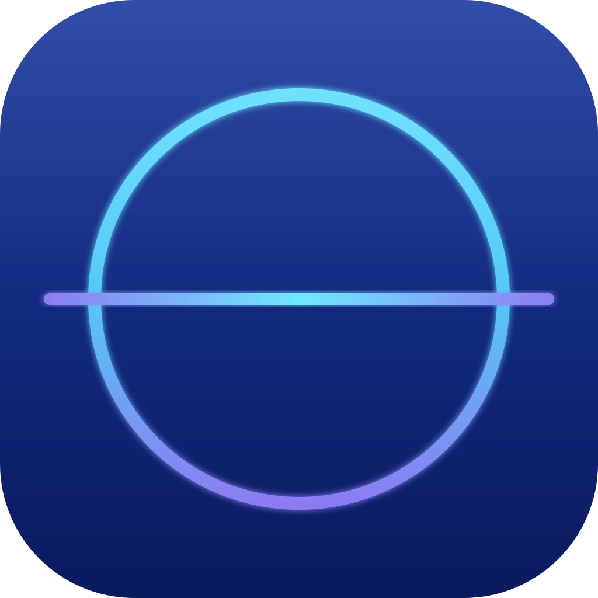

#  HorizonStudio

An environment for distributed software development with AI. **Studio** (a web interface) connects to **Agents** on local and remote machines (Windows/macOS/Linux) and runs **Tasks** on them with AI tools (Engines), such as Claude Code. Work continues when Studio disconnects and survives a machine reboot.

## Components

- `agent`: a service on the machine. It stores Tasks and Sessions and runs Engines. It is reachable only from localhost; remote access goes through an SSH tunnel.
- `launcher`: starts the right Agent version and rolls back failed updates.
- `studio`: the web server and frontend. Connects to Agents, and provides Tasks, Session chat and Agent updates.
- `protocol`: shared message types.

## Installation

Every machine with an Agent, and the machine with Studio, needs Node.js 22.18+ and git. The build is the same on all operating systems:

```sh
git clone https://github.com/sergey-orekhov/horizon-studio.git
cd horizon-studio
npm ci
npm run build
```

On the Agent's machine, log in to Claude Code as the user the Agent will run under: install [Claude Code](https://code.claude.com/docs/en/setup), run `claude` and log in (`/login`). The Agent uses these credentials. With a Claude subscription login, its work counts against the subscription's limits.

The Agent installs as a user service, without administrator rights. Run `install` from the repository directory, as the user the Agent will run under. The first install prints the **admin Access Token**. Save it, because it is not shown again. To check it works on any OS: `curl http://127.0.0.1:7400/health`.

### macOS

```sh
node packages/launcher/dist/launcher.mjs install
```

- The Agent registers as the LaunchAgent `dev.horizon.agent`: it starts when the user logs in and restarts after a crash. On a dedicated machine, turn on automatic login (System Settings → Users & Groups); otherwise after a reboot the Agent will not start until someone logs in.
- State: `launchctl print gui/$(id -u)/dev.horizon.agent`. Log: `~/.horizon-agent/agent.log`.
- To connect from another machine, turn on SSH: System Settings → General → Sharing → Remote Login.
- Uninstall: `node packages/launcher/dist/launcher.mjs uninstall`.

### Linux

```sh
node packages/launcher/dist/launcher.mjs install
```

- The Agent registers as the `systemd --user` service `horizon-agent`, and `install` turns on `loginctl enable-linger`: the Agent starts when the machine boots, with no user login, and restarts after a crash. This needs a distribution with systemd.
- State: `systemctl --user status horizon-agent`. Log: `~/.horizon-agent/agent.log`.
- To connect from another machine, `sshd` must be running with port forwarding allowed (`AllowTcpForwarding yes`, the default).
- Uninstall: `node packages/launcher/dist/launcher.mjs uninstall`.

### Windows

In PowerShell:

```powershell
node packages\launcher\dist\launcher.mjs install
```

- The Agent is added to autostart at user login (`HKCU\Software\Microsoft\Windows\CurrentVersion\Run`, value `HorizonAgent`) and runs in the background with no window. On a dedicated machine, turn on automatic login. The Launcher handles Agent crashes, but if the Launcher itself crashes, it does not restart until the next login.
- State: `reg query HKCU\Software\Microsoft\Windows\CurrentVersion\Run /v HorizonAgent`. Log: `%USERPROFILE%\.horizon-agent\agent.log`.
- To connect from another machine, install and start OpenSSH Server (PowerShell as administrator):
  ```powershell
  Add-WindowsCapability -Online -Name OpenSSH.Server~~~~0.0.1.0
  Set-Service sshd -StartupType Automatic; Start-Service sshd
  ```
- Uninstall: `node packages\launcher\dist\launcher.mjs uninstall`.

### Studio

```sh
node packages/studio/dist/server.mjs
```

Open http://127.0.0.1:7300 and add a Connection: a name, the Agent port (7400) and the Access Token. For a remote Agent, also fill in the host, the user and, if needed, the key in the SSH block. Remote Agents need the `ssh` client in PATH: macOS and Linux usually have it, and it is built in on Windows 10/11. The key must have no passphrase or be loaded in ssh-agent.

Studio is started by hand (a terminal, tmux, your own service). It cannot be installed as a service yet.

## Development

Requires Node.js 22.18+.

```sh
npm install
npm run typecheck
npm test
npm run build

npm run dev -w @horizon/agent -- --home ./.agent-home  # Agent; the Agent Home defaults to ~/.horizon-agent
npm run dev:server -w @horizon/studio  # Studio server on 127.0.0.1:7300 (HORIZON_STUDIO_PORT); config via --config, default ~/.horizon-studio/config.json
npm run dev -w @horizon/studio         # Studio frontend (Vite); /ws is proxied to the Studio server
```

### Installing the Agent as a service

```sh
npm run build
node packages/launcher/dist/launcher.mjs install [--home <Agent Home>] [--agent <Agent build, default packages/agent/dist>]
node packages/launcher/dist/launcher.mjs uninstall   # the Agent Home stays
```

`install` puts the Agent build in `<Agent Home>/versions/<version>` (running `npm install` for dependencies), copies the Launcher to `<Agent Home>/launcher/` and registers a user service, with no administrator rights: on macOS the LaunchAgent `dev.horizon.agent`, on Linux `systemd --user` `horizon-agent` plus `loginctl enable-linger`, and on Windows autostart at login (`HKCU\Software\Microsoft\Windows\CurrentVersion\Run`, value `HorizonAgent`). The Launcher runs the version from `<Agent Home>/current` and restarts the Agent after a crash. Agent output goes to `<Agent Home>/agent.log`, and on first install `install` prints the admin Access Token from there. The service gets PATH from the environment `install` ran in; other environment variables (for example, `ANTHROPIC_API_KEY`) are not passed to the service.

**Agent Update.** An admin clicks Update next to an Agent in Studio. The Studio server sends the local build `packages/agent/dist` to the Agent (`PUT /update`). The Agent puts it in `versions/<version>-<hash>`; builds with the same set of dependencies share them in `deps/`. The Agent then exits, and the Launcher starts the new version on trial. If within 30 seconds it has not started listening on the port, or if it crashes at startup, the Launcher rolls back to the previous version. Studio shows the result next to the Agent. The current and previous versions are kept. Only an Agent started by the Launcher can be updated.

The Agent runs Claude Code through the Claude Agent SDK with the credentials already set up on the machine (`claude` login or `ANTHROPIC_API_KEY`). Tasks are stored in `<Agent Home>/tasks/<id>/`: `workspace/` is the Task Directory and `sessions/*.jsonl` is the Session event log.

On first start the Agent creates the Member `admin` and prints their Access Token once. An admin creates other Members in Studio (the Member button next to an Agent): `user` sees only their own Tasks, and `admin` sees all of them. Access Tokens are issued and revoked there too. Revoking immediately closes connections opened with that token, and the last admin token cannot be revoked. The config is `<Agent Home>/config.json`: `port` (default 7400); `defaultPermissionMode`, the Permission Mode of new Tasks, `ask` (default) or `auto`; `allowUserAuto`, whether `user` Members may use `auto` (default `false`); `completedRetentionDays`, the number of days until a completed Task is permanently deleted (default 30). The connection is a WebSocket with an `Authorization: Bearer <token>` header.

**What the `user` level protects.** A `user` sees and controls only their own Tasks in Studio. It is not an OS-level boundary: every Engine runs as the Agent's OS user and is not confined to the Task Directory, so it can reach other Tasks, `members.json`, Engine credentials and SSH keys. In `auto` mode nothing stops it, so by default only an admin can use `auto`: a `user` who asks for it is refused, a `user` Task created without a mode gets `ask` even when `defaultPermissionMode` is `auto`, and at startup the Agent switches existing `auto` Tasks of `user` Members to `ask` and notes it in their Sessions. Set `allowUserAuto` only if you trust every `user` with full access to the machine. In `ask` mode a `user` still approves their own requests, so give `user` access only to people you would trust with the Agent's OS account.

A remote Agent connects through SSH: the Connection has the host, user, SSH port and key (optional fields come from `~/.ssh/config` and ssh-agent). Studio opens the tunnel with the system `ssh` (needed in PATH; on Windows, the built-in OpenSSH), keeps it open and reconnects after a drop. The key must have no passphrase or be loaded in ssh-agent. Studio keeps host keys in `known_hosts` next to its config and saves them on first connection.

## Documentation

- [CONTRIBUTING.md](CONTRIBUTING.md): project rules
- [CONTEXT.md](CONTEXT.md): glossary
- [docs/spec/mvp.md](docs/spec/mvp.md): MVP specification
- [docs/adr](docs/adr): architecture decisions
- [docs/design/guide.md](docs/design/guide.md): Studio design guide
